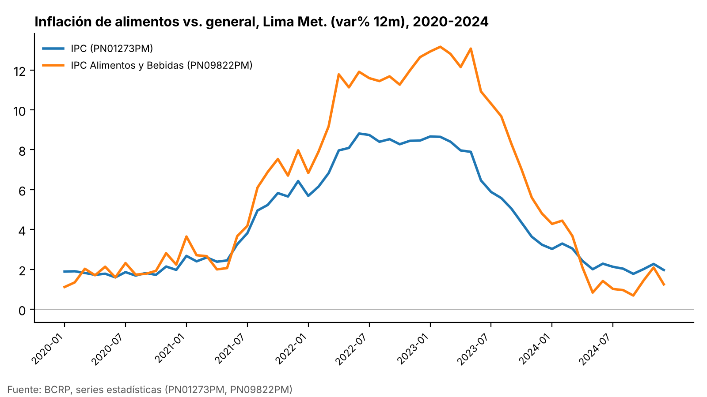
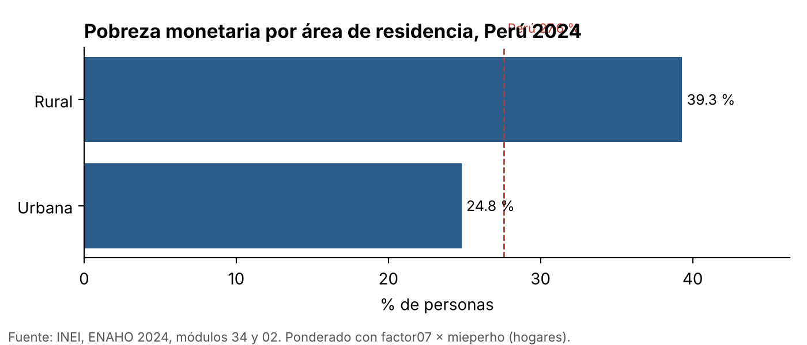
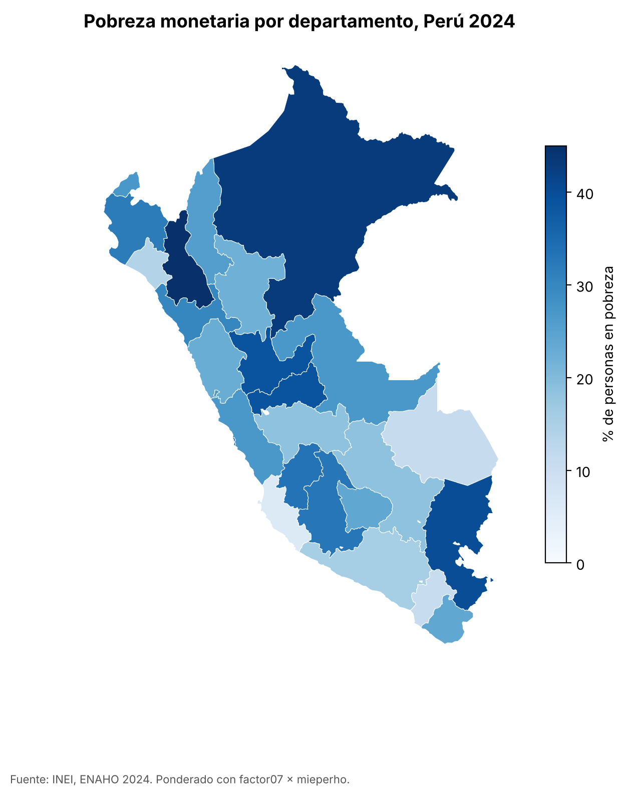

# Inflación de alimentos 2020-2024 y brechas de pobreza monetaria en el Perú, 2024

## Pregunta de investigación

¿Cómo evolucionó la inflación de alimentos frente a la inflación general en el Perú entre 2020 y 2024, y qué brechas urbano/rural y departamentales presentaba la pobreza monetaria al cierre de ese período según la ENAHO 2024?

## Fuentes y metodología

| Bloque | Fuente | Qué se usó | Cómo |
|---|---|---|---|
| Inflación | BCRP, estadísticas en línea, por el servidor MCP `bcrp` | **PN09822PM**: IPC de Lima Metropolitana, Alimentos y Bebidas (var% 12 meses). **PN01273PM**: IPC de Lima Metropolitana, total (var% 12 meses). Mensual, 2020-01 a 2024-12 (60 meses). | Los códigos se hallaron con `buscar_series`. Promedios, máximos, mínimos y valores de diciembre: `resumen`. Brecha, mes de mayor brecha y correlación: `comparar_series`. Figura: `graficar_serie`. Todas las cuentas las hizo la herramienta. |
| Pobreza | INEI, ENAHO 2024 (código 966), módulos 34 (sumaria) y 02 (miembros) | Pobreza monetaria total y extrema, por área y por departamento | Skill `limpiando-enaho` (base de personas validada contra el INEI), `graficando-enaho` (barras por área) y `mapeando-enaho` (mapa por departamento). Área y departamento se ponderan como el INEI: un registro por hogar con **`factor07 × mieperho`**. |

Archivos de salida: `salidas/cifras_bcrp.json`, `salidas/cifras_bcrp_comparacion.json`, `salidas/indicadores.csv`, `salidas/brechas_enaho.csv`, `mapas/pobreza_departamento.csv`, `salidas/validacion.txt`. Plan en `salidas/plan.md`.

**Alcance geográfico.** La inflación del BCRP corresponde a **Lima Metropolitana**. La pobreza es **nacional y departamental**. Los dos bloques no miden lo mismo ni en el mismo territorio. Por eso se presentan uno junto al otro, sin cruzarlos estadísticamente.

## Resultados

### Hallazgo 1. La inflación de alimentos subió más, llegó a su pico más tarde y bajó por debajo de la general en 2024

Valores de diciembre (var% 12 meses, Lima Metropolitana; herramienta `resumen`, guardados en `salidas/cifras_bcrp.json`):

| Diciembre | Alimentos y bebidas (PN09822PM) | IPC total (PN01273PM) |
|---|---|---|
| 2020 | 2.24 % | 1.97 % |
| 2021 | 7.97 % | 6.43 % |
| 2022 | 12.64 % | 8.46 % |
| 2023 | 4.80 % | 3.24 % |
| 2024 | 1.25 % | 1.97 % |

- **Picos.** La inflación general tocó su máximo en **2022-06 (8.81 %)**. La de alimentos lo tocó en **2023-02 (13.16 %)**, ocho meses después y más alta (`resumen`, PN01273PM y PN09822PM, 2020-01 a 2024-12).
- **Promedios del período.** Alimentos: **5.88 %**. General: **4.47 %** (`resumen`, 2020-01 a 2024-12).
- **Mínimos.** Alimentos: **0.69 % en 2024-09**. General: **1.60 % en 2020-06**.
- Al cierre del período el orden se invirtió: en dic-2024 los alimentos (1.25 %) quedaron por debajo de la inflación general (1.97 %).

### Hallazgo 2. La brecha alimentos − general promedió 1.42 puntos, con un máximo de 5.18 puntos en mayo de 2023

Herramienta `comparar_series(PN09822PM, PN01273PM, 2020-01, 2024-12)`, guardada en `salidas/cifras_bcrp_comparacion.json`:
- 60 meses comunes, ninguno descartado.
- Brecha promedio (alimentos − general): **1.42 puntos porcentuales**.
- Mayor brecha: **5.18 pp en 2023-05**.
- La inflación de alimentos superó a la general en **44 de los 60 meses**.
- Correlación de Pearson entre las dos series: **0.98**. Las dos se movieron juntas en dirección, pero los alimentos tuvieron más amplitud. Esta correlación es descriptiva y en parte es mecánica, porque alimentos y bebidas forman parte del IPC total.

### Hallazgo 3. En 2024 la pobreza rural superó a la urbana por 14.5 puntos

Fuente: `salidas/indicadores.csv` y `salidas/brechas_enaho.csv`, ponderado con `factor07 × mieperho`. Las cifras validan contra el INEI (`salidas/validacion.txt`: VALIDADA).
- Pobreza nacional: **27.58 %**. Pobreza extrema nacional: **5.50 %**.
- Rural: **39.30 %**. Urbana: **24.81 %**. Brecha: **14.49 pp**. Razón rural/urbana: **1.58**.
- En pobreza extrema la brecha es todavía más marcada en términos relativos: rural **15.52 %** y urbana **3.14 %** (brecha de **12.38 pp**).
- La población rural es el **19.13 %** de la población expandida. Aunque la tasa rural es mayor, la mayor parte de las personas pobres vive en áreas urbanas por el peso demográfico. Esta lectura sale de las poblaciones expandidas de `salidas/indicadores.csv`; la composición exacta de la población pobre no se calculó.

### Hallazgo 4. La pobreza departamental iba de 6.0 % en Ica a 45.0 % en Cajamarca

Fuente: `mapas/pobreza_departamento.csv` (skill `mapeando-enaho`), con 25 departamentos y Lima y Callao por separado, ponderado con `factor07 × mieperho`. Coincide 7/7 con la referencia de la Sesión 16 (`mapas/comparacion_sesion16.csv`).
- **Departamentos con más pobreza:** Cajamarca 45.0 %, Loreto 43.0 %, Puno 39.9 %, Pasco 39.0 % y Huánuco 39.0 %. Son 5 departamentos con 38 % o más.
- **Departamentos con menos pobreza:** Ica 6.0 %, Moquegua 11.0 %, Madre de Dios 11.1 % y Lambayeque 14.0 %.
- Brecha entre el máximo y el mínimo: **39.0 pp**. Hay **10 de 25** departamentos por encima del promedio nacional (`salidas/brechas_enaho.csv`).
- El departamento de Lima (código 15, que incluye Lima Metropolitana y Lima provincias) registra **27.1 %**, muy cerca del promedio nacional. Callao registra **33.9 %**.

## Visualizaciones

**Figura 1.** Inflación de alimentos y bebidas frente a la inflación general, Lima Metropolitana, var% 12 meses, 2020-01 a 2024-12 (BCRP, PN09822PM y PN01273PM; `graficar_serie`).



**Figura 2.** Pobreza monetaria por área de residencia, Perú 2024 (ENAHO; `factor07 × mieperho`; skill `graficando-enaho`).



**Figura 3.** Pobreza monetaria por departamento, Perú 2024 (ENAHO; `factor07 × mieperho`; skill `mapeando-enaho`).



## Interpretación

Entre 2020 y 2024, en Lima Metropolitana, la inflación de alimentos acompañó a la inflación general en dirección (correlación de 0.98), pero con más amplitud. Subió más (13.16 % frente a 8.81 % en el pico), se mantuvo alta más tiempo (pico en 2023-02 frente a 2022-06) y luego cayó por debajo de la general en la segunda mitad de 2024. En 44 de los 60 meses, los precios de alimentos crecieron más rápido que la canasta total.

Al cierre del período, la pobreza monetaria de 2024 muestra dos brechas marcadas:
- **Rural frente a urbano:** 39.3 % frente a 24.8 %.
- **Entre departamentos:** de 6.0 % en Ica a 45.0 % en Cajamarca. Los niveles más altos se concentran en departamentos de sierra norte y centro, de la Amazonía (Loreto) y del altiplano (Puno).

Hay una coincidencia temporal: el episodio de alta inflación de alimentos (2021-2023) ocurrió antes del corte de pobreza de 2024. Estudiarla exigiría datos que este informe no usa, como la ENAHO de años anteriores o la estructura de gasto de los hogares. Con estos datos, **no se puede afirmar que la inflación de alimentos haya determinado los niveles o las brechas de pobreza**: solo se describe que ambos fenómenos coinciden en el período.

## Limitaciones

- **Territorio distinto.** El IPC del BCRP usado aquí es de Lima Metropolitana, no nacional ni departamental. No se analizó la inflación en zonas rurales ni por departamento, que puede haber sido diferente.
- **Tiempo distinto.** La inflación es una serie mensual de 2020 a 2024. La pobreza es un único corte transversal de 2024. No se analiza la evolución de la pobreza entre 2020 y 2024, porque solo se procesó la ENAHO 2024.
- **Sin causalidad.** Las comparaciones y la correlación son descriptivas.
- **Error muestral.** Las cifras departamentales vienen de muestras de entre 603 hogares (Madre de Dios) y 4,544 hogares (Lima) (`n_muestra` en `salidas/indicadores.csv`). No se calcularon intervalos de confianza, así que diferencias pequeñas entre departamentos (por ejemplo, Pasco y Huánuco con 39.0 %) no deben ordenarse con certeza.
- **Método de ponderación.** Área y departamento usan el método del INEI (`factor07 × mieperho`). Con `facpob07` sobre la base de personas, el área sale 24.7 % urbana y 39.4 % rural. La diferencia es de método.
- **Indicador de la herramienta descartado.** La `variacion_pct` que reporta `comparar_series`/`resumen` (cambio porcentual de una tasa entre el primer y el último mes) no se usa porque no tiene interpretación económica útil.
- **Incidencia técnica.** Durante la verificación, la API del BCRP respondió dos veces con una página HTML de su protección antibots en lugar de JSON. La verificación se volvió a correr sin cambios y completó todas las consultas.

## Verificación

Tabla generada por `.claude/skills/investigando-peru/scripts/verificar.py` (`salidas/verificacion.md`). El script recalcula las cifras de forma independiente: vuelve a consultar la API del BCRP con httpx y vuelve a leer `sumaria-2024.dta` con pandas, sin pasar por el servidor MCP ni por los scripts de las skills.

| Fuente   | Afirmación                                                                                    |   Valor en el informe |   Valor recalculado |   Diferencia |   Tolerancia | Coincide   | Cómo se verificó                                                             |
|:---------|:----------------------------------------------------------------------------------------------|----------------------:|--------------------:|-------------:|-------------:|:-----------|:-----------------------------------------------------------------------------|
| BCRP     | Inflación de alimentos y bebidas, Lima Metropolitana (var% 12m): promedio ene-2020 a dic-2024 |                  5.88 |                5.88 |        0     |         0.01 | Sí         | API BCRP PN09822PM 2020-01–2024-12, promedio con pandas                      |
| BCRP     | Inflación general IPC, Lima Metropolitana (var% 12m): promedio ene-2020 a dic-2024            |                  4.47 |                4.47 |        0     |         0.01 | Sí         | API BCRP PN01273PM 2020-01–2024-12, promedio con pandas                      |
| BCRP     | Inflación de alimentos y bebidas, Lima Metropolitana (var% 12m): máximo del periodo (2023-02) |                 13.16 |               13.16 |       -0     |         0.01 | Sí         | API BCRP PN09822PM 2020-01–2024-12, maximo con pandas                        |
| BCRP     | Inflación general IPC, Lima Metropolitana (var% 12m): máximo del periodo (2022-06)            |                  8.81 |                8.81 |       -0     |         0.01 | Sí         | API BCRP PN01273PM 2020-01–2024-12, maximo con pandas                        |
| BCRP     | Inflación de alimentos y bebidas, Lima Metropolitana (var% 12m): mínimo del periodo (2024-09) |                  0.69 |                0.69 |        0     |         0.01 | Sí         | API BCRP PN09822PM 2020-01–2024-12, minimo con pandas                        |
| BCRP     | Inflación general IPC, Lima Metropolitana (var% 12m): mínimo del periodo (2020-06)            |                  1.6  |                1.6  |       -0     |         0.01 | Sí         | API BCRP PN01273PM 2020-01–2024-12, minimo con pandas                        |
| BCRP     | Inflación de alimentos y bebidas, Lima Metropolitana (var% 12m): ene-2020                     |                  1.11 |                1.11 |        0     |         0.01 | Sí         | API BCRP PN09822PM 2020-01–2020-01, valor con pandas                         |
| BCRP     | Inflación general IPC, Lima Metropolitana (var% 12m): ene-2020                                |                  1.89 |                1.89 |        0     |         0.01 | Sí         | API BCRP PN01273PM 2020-01–2020-01, valor con pandas                         |
| BCRP     | Inflación de alimentos y bebidas, Lima Metropolitana (var% 12m): dic-2020                     |                  2.24 |                2.24 |        0     |         0.01 | Sí         | API BCRP PN09822PM 2020-12–2020-12, valor con pandas                         |
| BCRP     | Inflación general IPC, Lima Metropolitana (var% 12m): dic-2020                                |                  1.97 |                1.97 |       -0     |         0.01 | Sí         | API BCRP PN01273PM 2020-12–2020-12, valor con pandas                         |
| BCRP     | Inflación de alimentos y bebidas, Lima Metropolitana (var% 12m): dic-2021                     |                  7.97 |                7.97 |        0     |         0.01 | Sí         | API BCRP PN09822PM 2021-12–2021-12, valor con pandas                         |
| BCRP     | Inflación general IPC, Lima Metropolitana (var% 12m): dic-2021                                |                  6.43 |                6.43 |        0     |         0.01 | Sí         | API BCRP PN01273PM 2021-12–2021-12, valor con pandas                         |
| BCRP     | Inflación de alimentos y bebidas, Lima Metropolitana (var% 12m): dic-2022                     |                 12.64 |               12.64 |        0     |         0.01 | Sí         | API BCRP PN09822PM 2022-12–2022-12, valor con pandas                         |
| BCRP     | Inflación general IPC, Lima Metropolitana (var% 12m): dic-2022                                |                  8.46 |                8.46 |        0     |         0.01 | Sí         | API BCRP PN01273PM 2022-12–2022-12, valor con pandas                         |
| BCRP     | Inflación de alimentos y bebidas, Lima Metropolitana (var% 12m): dic-2023                     |                  4.8  |                4.8  |        0     |         0.01 | Sí         | API BCRP PN09822PM 2023-12–2023-12, valor con pandas                         |
| BCRP     | Inflación general IPC, Lima Metropolitana (var% 12m): dic-2023                                |                  3.24 |                3.24 |        0     |         0.01 | Sí         | API BCRP PN01273PM 2023-12–2023-12, valor con pandas                         |
| BCRP     | Inflación de alimentos y bebidas, Lima Metropolitana (var% 12m): dic-2024                     |                  1.25 |                1.25 |       -0     |         0.01 | Sí         | API BCRP PN09822PM 2024-12–2024-12, valor con pandas                         |
| BCRP     | Inflación general IPC, Lima Metropolitana (var% 12m): dic-2024                                |                  1.97 |                1.97 |       -0     |         0.01 | Sí         | API BCRP PN01273PM 2024-12–2024-12, valor con pandas                         |
| ENAHO    | Pobreza monetaria nacional 2024 (%)                                                           |                 27.58 |               27.58 |        0.001 |         0.05 | Sí         | sumaria-2024.dta leída de nuevo, factor07 × mieperho; referencia INEI 27.6 % |
| ENAHO    | Pobreza rural 2024 (%)                                                                        |                 39.3  |               39.3  |       -0.003 |         0.05 | Sí         | estrato 6-8; referencia 39.3 %                                               |
| ENAHO    | Pobreza urbana 2024 (%)                                                                       |                 24.81 |               24.81 |        0.003 |         0.05 | Sí         | estrato 1-5; referencia 24.8 %                                               |
| ENAHO    | Departamento con más pobreza: Cajamarca (%)                                                   |                 45    |               45.01 |       -0.007 |         0.05 | Sí         | sumaria por ubigeo[:2] = 06; referencia Sesión 16 45.0 %                     |
| ENAHO    | Departamentos en el mapa                                                                      |                 25    |               25    |        0     |         0    | Sí         | ubigeo[:2] distintos en la sumaria                                           |

**Resultado:** 23/23 cifras coinciden.

La brecha promedio (1.42 pp), el mes de mayor brecha (2023-05) y la correlación (0.98) vienen de `comparar_series`. El script de verificación no las recalcula, pero sí recalcula los promedios de ambas series de los que se deriva la brecha promedio: 5.88 − 4.47 ≈ 1.42.

## Reproducibilidad

Desde la raíz del repo:

```bash
# 1. ENAHO: limpieza y validación contra el INEI (skill limpiando-enaho)
uv run .claude/skills/limpiando-enaho/scripts/limpiar.py --anio 2024
# 2. Gráfico por área (skill graficando-enaho)
uv run .claude/skills/graficando-enaho/scripts/graficar.py --por area
# 3. Mapa departamental (skill mapeando-enaho)
uv run .claude/skills/mapeando-enaho/scripts/mapear.py
# 4. Brechas derivadas de los indicadores
uv run python salidas/scripts/brechas_enaho.py
# 5. Registro de cifras BCRP obtenidas por MCP
uv run python salidas/scripts/guardar_bcrp.py
# 6. Verificación independiente
uv run .claude/skills/investigando-peru/scripts/verificar.py
```

Llamadas al servidor MCP `bcrp` (consultadas el 2026-11-04):
- `buscar_series("ipc 12 meses", "Mensual")` y `buscar_series("alimentos", "Mensual")`
- `comparar_series("PN09822PM", "PN01273PM", "2020-01", "2024-12")`
- `resumen("PN09822PM" | "PN01273PM", "2020-01", "2024-12")` y `resumen(..., "AAAA-12", "AAAA-12")` para cada año entre 2020 y 2023
- `graficar_serie(["PN01273PM", "PN09822PM"], "2020-01", "2024-12")` → `figuras/inflacion_alimentos_vs_general_2020_2024.png`

Fuentes BCRP:
- https://estadisticas.bcrp.gob.pe/estadisticas/series/api/PN09822PM/html/2020-1/2024-12
- https://estadisticas.bcrp.gob.pe/estadisticas/series/api/PN01273PM/html/2020-1/2024-12

Datos ENAHO: `datos/966-Modulo34.zip` y `datos/966-Modulo02.zip` (INEI, ENAHO 2024).
